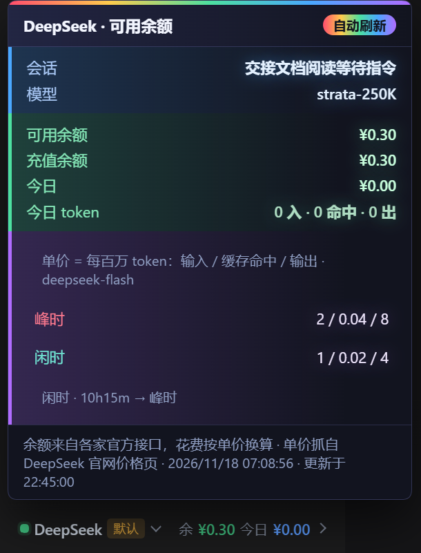

# dsh-api-costbar — 云端 API 费用读数条

一个可以快速查看云端模型api费用的插件，支持手动切换厂商，支持调节刷新频率。

落到实处就是：DSH 侧栏底部那一格里显示你接入的云端 API 账户——**余额、今日花费、当前会话用的模型、每百万 token 的峰谷单价、离下次峰谷切换还有多久**（赠金为 0 时不单列，真有了才出现）。只切换"这里显示哪个账户"，**不改 DSH 当前用的模型**。

## 安装

- 插件市场搜 `dsh-api-costbar`，或命令行 `dsh plugin --profile web add dsh-api-costbar`。市场目录每天重建一次，新发布大约晚一天才装得到，装不到别重复发版。
- 本地源码试装：`plugin_manager` 的 `install_bundle` 指到仓库目录即可。
- **装好即生效，没有总开关**；要在这一格里看哪家，就去「设置 › API 费用」给那家填一个 **API Key 引用名**（是引用名，不是 Key 本身，Key 从不写盘）。

## 它做什么

- 自动枚举 DSH 里接入的厂商（DeepSeek / OpenRouter / Kimi（月之暗面） / 智谱 GLM），**能读到余额的才列出**，读不到的写出原因（没配 Key / 这家没有余额接口），不编数字。
- 余额走各家官方接口：DeepSeek `/user/balance`、OpenRouter `/api/v1/key`（回落 `/api/v1/credits`）、Moonshot `/v1/users/me/balance`、智谱 `/api/biz/account/query-customer-account-report`。卡片上的"余"是充值 + 赠金之和；**赠金为 0 时那一行不摆**（可能一年遇不到一次），真有了才出现，那时"余"比"充值"多出来的钱才对得上账。
- 「今日」与本会话花费**不是查接口查来的**——各家给 API Key 的接口只有余额，用量明细那张表是官网登录态的网页接口。算法：客户端每次上报所有会话的**累计** token，宿主与上次累计做差、按当时的峰谷档乘单价折算成钱累进"今天"。同一份 token 重复上报不加钱；宿主离线期间的用量不补记；**第一次见到某个会话只建基线**，不把它的历史 token 算进今天（那些可能是几天前按别的档位花的）。只统计 **DSH 自己发出的请求**：别的软件或脚本用同一个 Key 花的钱不进"今日"，但会照样扣余额。
- 峰谷口径：北京时间工作日 9:00–12:00、14:00–18:00 算峰时，周末与法定节假日算闲时。节假日表内置，可在设置页用 `holidays`（逗号分隔的 `YYYY-MM-DD`）覆盖。
- **按会话跟随**：切到哪个会话，那一格就换成那个会话的真实模型与花费。会话跑本地模型（127.0.0.1 这类端点）或该厂商读不到用量时，整格改用设置里的默认厂商（初始 deepseek）并亮琥珀灯，鼠标悬停给原因。
- **「默认」标签**：这一格显示的正是设置里的默认厂商时，挂一个琥珀「默认」标签（跟账户与模型列表里那个标签同一个样式）；手动切去看别家就不挂。悬停告诉你为什么。

## 怎么用

- 单击那一格 → 展开计费明细；再点一次 / 点别处 / `Esc` → 关闭。
- 计费明细**顶上有个「自动刷新」开关**：关掉就不再自动取数——余额、单价、今日全冻住，**设置里的刷新间隔也不生效**；开回来立刻刷一次。选择记在宿主的设置里（`autoRefresh`），重启或换窗口都记得。关着的时候「刷新单价」按钮和手动打开设置页照样取数（那是手动，不是自动）。
- 点厂商与模型名 → 账户与模型列表：点别家即切换显示内容，点「设为默认」改回落用的默认厂商。
- 设置 → 「API 费用」那一节：默认厂商、刷新间隔（秒）、**「刷新单价」按钮**、每个厂商用哪个 Key 引用、节假日覆盖。单价不用你填：插件每天第一次读数时自己去各家查一次（最多等 3 秒，等不到先按上次的价算）；想马上重查就点那个按钮，成败直接写在按钮上（例如「有几家没刷到 1/2（OpenRouter: 超时）」）。
- **读不到的条目不摆这一行**（不用「—」占位、不摆"读不懂"的说明）：各家**给 API Key 的接口里没有「累计消费」这个数**——DeepSeek 的 `GET /user/balance` 官方 Schema 只有 `is_available` 和 `currency / total_balance / granted_balance / topped_up_balance`（实测原始返回一字不差），官网用量页那个累计数字来自控制台的登录态网页，所以 DeepSeek 名下不会出现「已消费」行；OpenRouter 的接口给 `total_spent`，它就会出现在 OpenRouter 名下。同理：会话跑本地模型就不摆 token / 花费行，单价没查到就整个单价块都不出现。
- 单价从哪来：OpenRouter 读它免 Key 的 `/api/v1/models`（JSON，每个模型自带定价，连时段价都给）；DeepSeek 只有官网文档页写着价，就去啃那个网页。查失败**沿用上次查到的**，上次也没有才用内置价，明细底下写明"单价抓自哪儿、几月几时刻"以及"这次没查到、沿用的是上次的"，不悄悄拿旧价冒充新价。查来的价存 `prices.json`。匹配模型名时忽略大小写与 `-`、`_`、空格，所以 `deepseek-v4-pro` 与 `DeepSeek V4 Pro` 算同一档。
- 内置兜底价（也抓自各家官网，DeepSeek 那份是 2026-11 的官方价格页）：DeepSeek-Flash 峰时 `2 / 0.04 / 8`、闲时 `1 / 0.02 / 4`；DeepSeek-V4-Pro 峰时 `9 / 0.3 / 27`、闲时 `4.5 / 0.15 / 13.5`（每百万 token：输入未命中 / 缓存命中 / 输出，人民币）。OpenRouter 按美元计价，它给的时段价取最高的当峰时、最低的当闲时（它的峰谷窗口和 DeepSeek 不是一个口径，界面会写明价是从 OpenRouter 查的）。

## 数据与隐私

- 余额实时从各家官方接口取，**不落盘**；本地只存每日花费累计、查来的单价与设置，位置在 `DSH_HOME/profiles/<profile>/ext/dsh-api-costbar/`。
- API Key 从不写盘：宿主经凭据服务（`ctx.credentials.resolve`）按引用名取，取不到时兜底读凭据文件里的 `refs:` 段；日志与自报只报引用名和字符长度。
- 单价是**当网页来啃**的（除了 OpenRouter 给了 JSON）：官网改版就可能解析失败，那时就沿用上次查到的并在界面上说明，不会因为查不到就不算钱。内置那份只是第一次还没查到时的兜底。
- 价表里没有的模型不猜价：那一格照样显示模型名，金额给「—」，明细里写清是哪一档没价，并指你去「设置 › API 费用」看单价查询状态。DSH 里 provider 的名字是用户自己起的（比如 `deepseek-official`），插件按接口域名与名字里的厂商字样归到对应厂商，自取名字不影响算钱。

## 排查

宿主路由 `GET /api/dsh-api-costbar` 返回全部读数，另有两个自诊字段：

- `clientReport` —— 浏览器那一半注册了什么、槽位报了什么错（插件不显示时先看这里）。
- `?debug=1` 额外给出凭据解析轨迹与宿主对客户端模块的登记情况。

## 兼容

宿主半边只需 `apply()`；浏览器半边是懒工厂注册进 `sidebar.footer.action` / `conversation.composer.dock` / `settings.section`，样式只用宿主的 `--dsw-*` 变量，跟随宿主主题。读不到的服务一律降级，不抛错。

## 更新

### v0.3.8（2026-11-18）

- **计费明细面板换了配色**：面板顶上一条彩虹色带，会话 / 余额 / 单价三块各自多一条同色左边框（蓝 / 绿 / 紫），底色与文字一起提亮，不再是一整片发灰的深色；顶上那颗「自动刷新」药丸换成彩虹底。
- **峰时、闲时两行分得出颜色了**：峰时暖红、闲时冷青，一眼看出当下是高峰档还是闲时档（之前这两行跟正文同一个灰）。
- 侧栏底部那一格常驻读数**颜色一律没动**，仍跟随宿主主题。

### v0.3.7（2026-11-16，首次发布）

- 侧栏底部那一格：当前会话的模型、余额、今日与本会话花费、每百万 token 峰谷单价与峰谷倒计时；会话跑本地模型或那家读不到用量时改用设置里的默认厂商并标出原因，显示的正是默认厂商时挂「默认」标签。
- 点金额出**计费明细**，点厂商名出**账户与模型列表**（切换显示内容、设为默认）。明细顶上那颗「自动刷新」药丸：关掉就不再自动取数（余额、单价、今日冻住，**设置里的刷新间隔也不生效**），「刷新单价」按钮仍然随时能点，选择记在宿主设置里。两个面板都没有 × 关闭按钮——再点那一格、点面板外、`Esc` 都能关。
- 单价全自动：每天首次读数时自己去各家查一次（OpenRouter 读它免 Key 的 JSON，DeepSeek 啃官网价目页），查不到沿用上次查到的并在界面写明来源与抓取时刻；设置里那一节只有「刷新单价」按钮，**没有单价输入框**。
- 读不到的条目一律**不摆这一行**：不用「—」占位，也不摆"读不懂"的说明。DeepSeek 官方余额接口只有四个字段、没有「累计消费」这个数，所以 DeepSeek 名下不出现「已消费」行；赠金为 0 也不摆行。

MIT。
